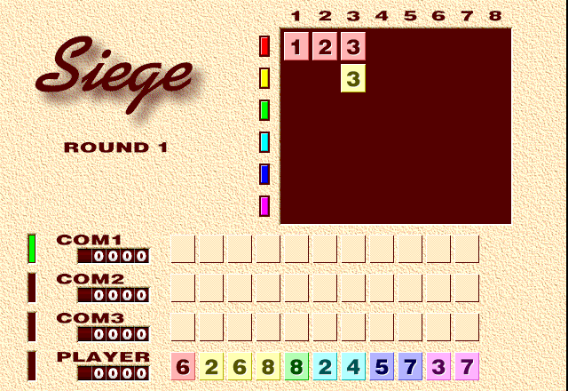

Play the original **Siege 1.1**, a card strategy game by NAGI-P SOFT. Place cards
next to those already on the board and try to enclose spaces belonging to your
opponents. The computer plays three hands; the round ends when no cards can be
played.

The original shareware registration notice remains. Native card placement and one
local browser round are verified; hosted browser qualification is pending.

