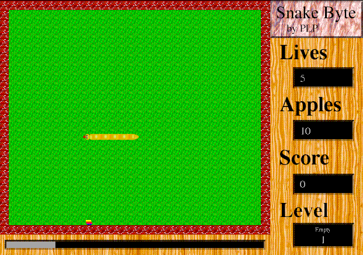

## Eat your apples

Guide your snake to eat apples. Each one makes it longer and faster. Eat enough
apples to open the way to the next level, and avoid walls, rocks and your own
tail.

Click **OK** on the welcome window, then choose **File > New Game**. The left and
right arrow keys turn the snake relative to its heading. Click to pause.
