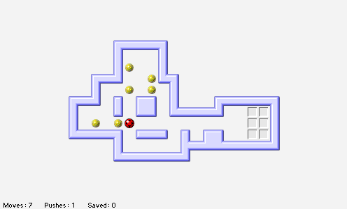

Press **Return** at startup, enter a player name and accept. Use arrow keys or
click adjacent squares to move. Push each treasure chest onto a destination;
chests cannot be pulled. **Escape** undoes a move; **Space** redoes it.

The bounded native replay verifies movement and a chest push against an
omitted-input control. Browser qualification, completed levels, startup-notice
fidelity, saved progress and audio remain unverified. Launch stays disabled
pending browser approval.
