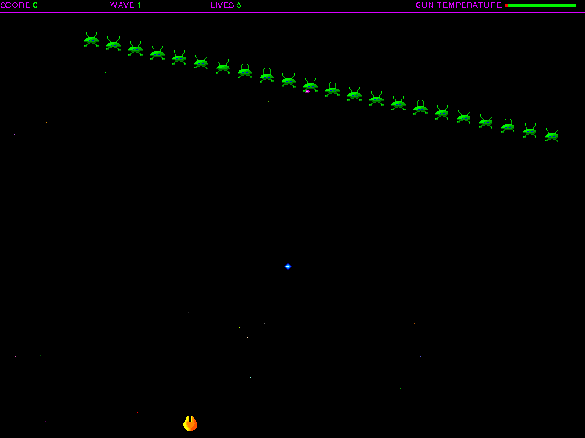

Choose **Not Yet** to try the original unregistered game, then **New Game**.
Wait for the hyperspace and wave introduction. In the original Mouse mode, move
the mouse to steer and hold the mouse button to fire. Enemy hits/scoring, later
waves, keyboard mode, registration features, persistence and sound fidelity are unverified.

Native movement/firing and matched controls are verified. Hosted-browser input
and pacing, and released public play remain unverified.
