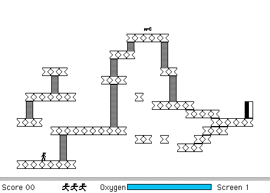

Play the original **Spacestation Pheta 2.7** unregistered shareware edition by
Tad Woods. The complete original package includes its main screens, release
notes and two additional screen files. Registration-only features retain their
original restrictions.

Choose **Not Yet**, then **Pheta → New Game**. **L** walks right using the original
keyboard assignment. First-screen native movement is verified; browser approval
is pending.

Game Options initially has blank keyboard labels, Quick Playing Instructions
is blank, and closing Options can damage the playfield. Broader progression,
jumping, saving and audio remain unverified.

