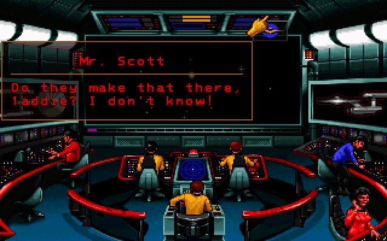

## One more mission

Judgment Rites combines dialogue, investigation and away-team puzzles in an
episode shaped like the original television series. This is Interplay's
complete Macintosh preview image. The 68K version reaches the bridge and advances
interactive dialogue. The package also includes a native PowerPC version whose
startup remains under investigation; browser launch stays disabled. Saving is
disabled in the original demo.
