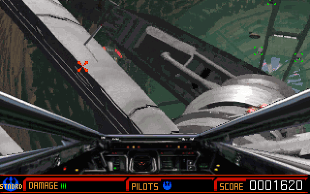

From Game Main Menu, choose Start Game, add a Standard pilot, then select
Chapter 6 — The Mining Facility. Move the mouse to aim and hold its button to fire.
The complete original demo retains its readmes, joystick utilities and settings.

Native testing verifies bounded laser firing against an omitted-button control.
A complete chapter and browser compatibility remain unverified; browser launch
stays disabled pending qualification.
