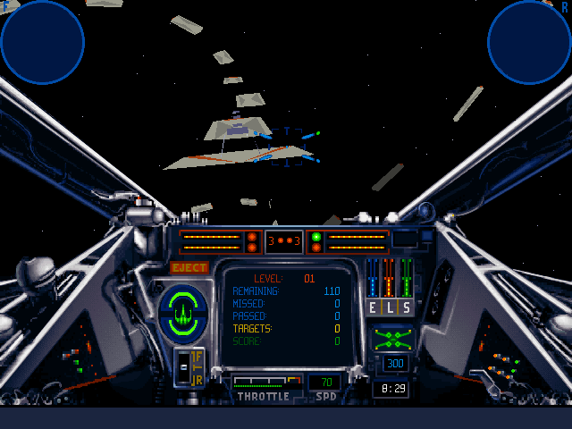

Enter the left concourse door, **Fly X-Wing Training Mission**, to practise
flying through the maze. The demo also offers the **Destroy Troop Convoy**
historical mission. The original Read Me explains both missions and controls.

The default flight control uses the mouse; the cursor keys also steer.
Click to fire, **F** toggles the X-Wing’s S-foils, and **+ / -** adjust throttle.

Native PowerPC testing verifies entry into training and bounded steering.
The 68K slice has incomplete cockpit/world rendering. Browser input, pacing,
combat, mission completion, persistence and audio fidelity remain unverified,
so browser launch is disabled.
