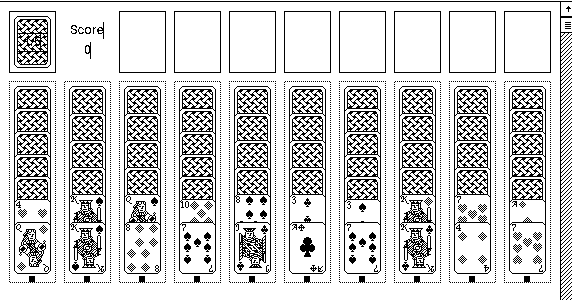

## Spin your web

Two decks are dealt into ten columns. Build down regardless of suit, and remove
complete runs from king to ace of a single suit. When you're stuck, deal another
row from the stock.

Click **OK** on the unregistered notice. Drag cards to move them, and click the
stock in the top-left corner to deal.
