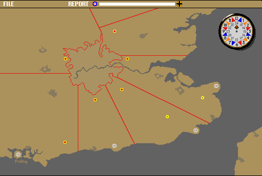

## Scramble

Radar stations along the coast report incoming raids. Watch the plotting map, judge the threat and send fighter squadrons up in time to meet the bombers.

Click on the map and use the File and Report menus to manage the battle.
