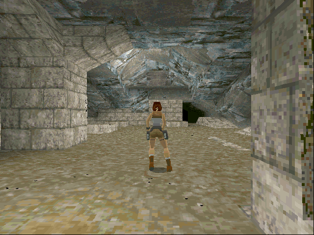

## Enter the lost ruins

Guide Lara Croft through caves and ruins in the original Power Macintosh demo of
Tomb Raider Gold. The demo includes part of the second level of Tomb Raider I.

Click **OK** on the first-run hardware notice. Press Return to choose **Game**,
then Return again for **New Game**. Use the arrow keys to run and turn, Command to
jump, Control for actions, Shift to walk and Space to draw weapons. Press Escape
for the inventory ring.
