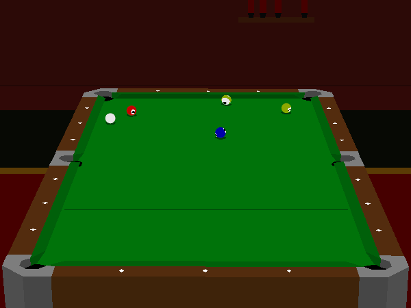

Play the original Macintosh **Virtual Pool** four-ball preview. Hit the lowest
numbered ball first and try to pocket the 9 ball.

Click the title and press **Return** to dismiss the shooting help. Press and release
**S** to enter Shoot Mode, then hold **S** while moving the mouse backward and forward
to stroke the cue. Press **Escape** for menus and the built-in control help.

A native break shot is verified. Browser qualification remains pending.

