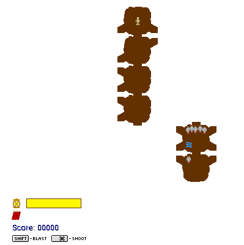

## Hunt the Wumpus

Wander the caverns with a single tranquilliser dart, a lantern, a few sticks of
dynamite and a canary. Read the clues, avoid the hazards and get the Wumpus before
it gets you.

Use the arrow keys to move between caverns. Hold Command and press an arrow to
shoot, and hold Shift and press an arrow to blast with dynamite.
