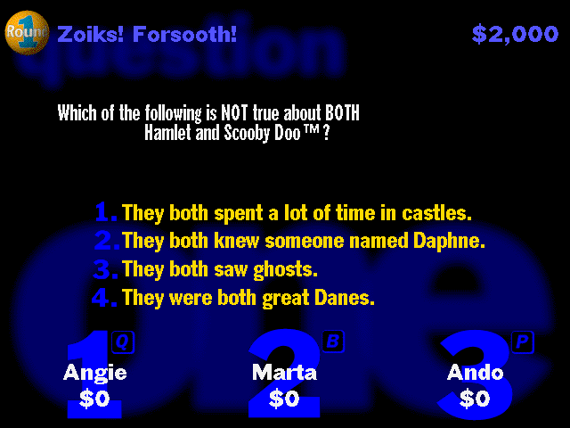

The complete original five-question demo preserves its questions, sound, graphics,
installer and supplied QuickTime and Sound Manager components.

Choose a category with 1, 2 or 3. The players' buzzer keys are Q, B and P; buzz in
and use a number key to answer. The native 68k run verifies category selection,
buzzing in and answer-driven advancement.

Browser launch stays disabled pending qualification. The original PowerPC slice
also has a separate [PEF loading issue](https://github.com/benletchford/systemless/issues/6078).
